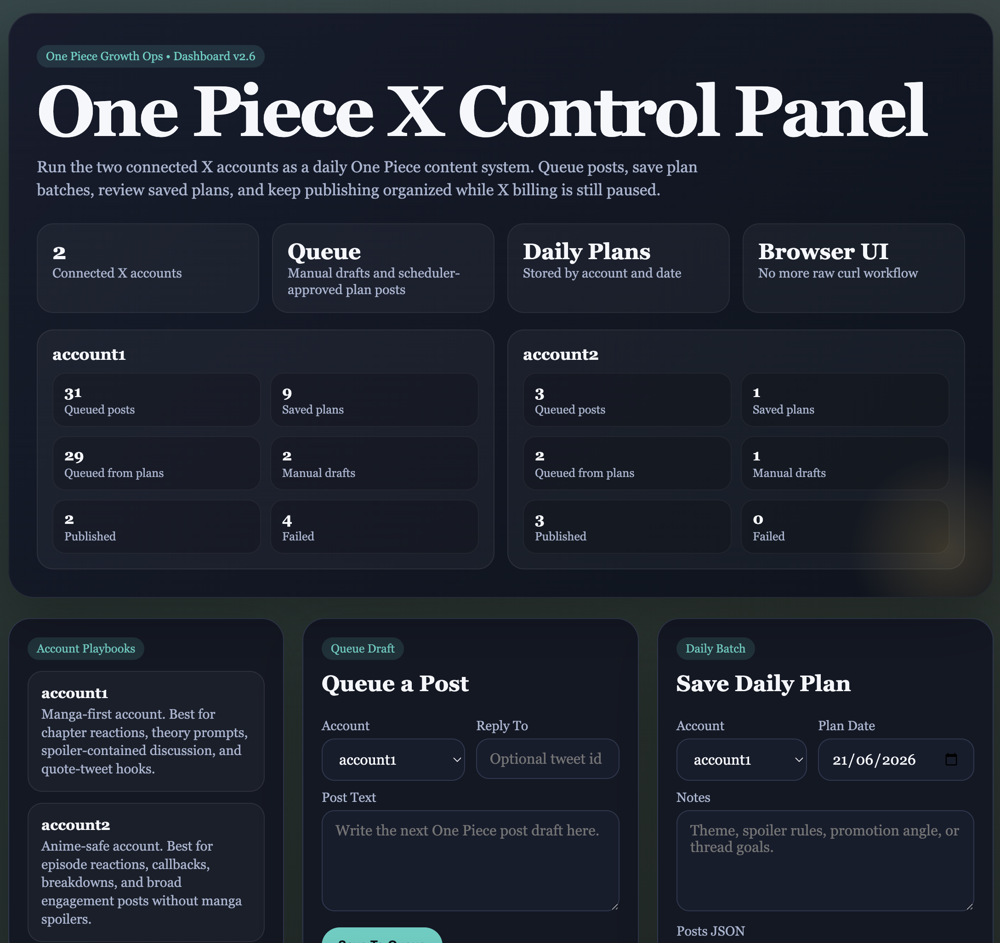
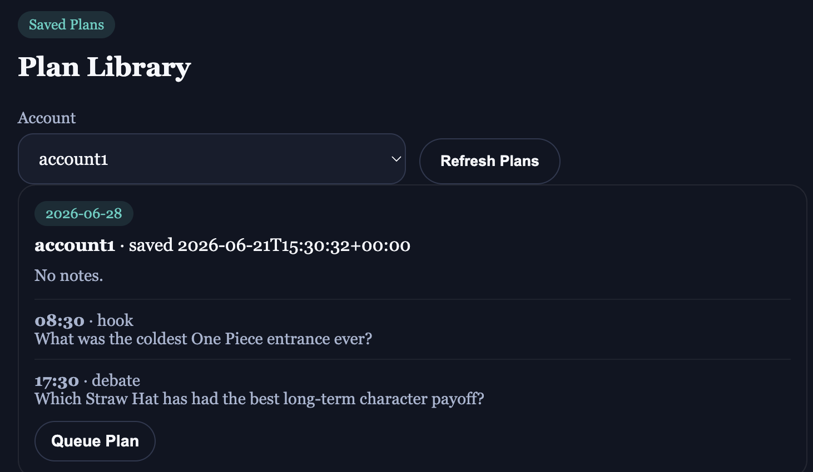
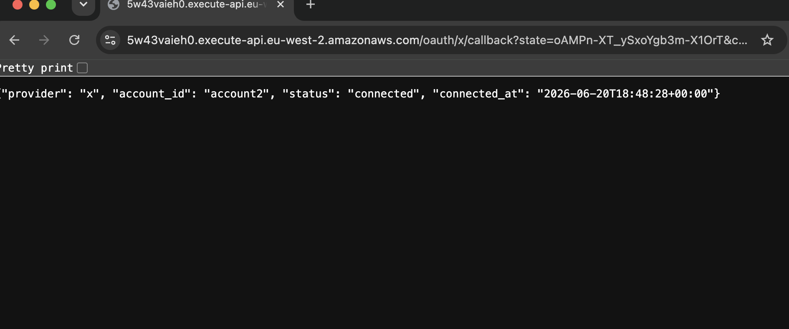
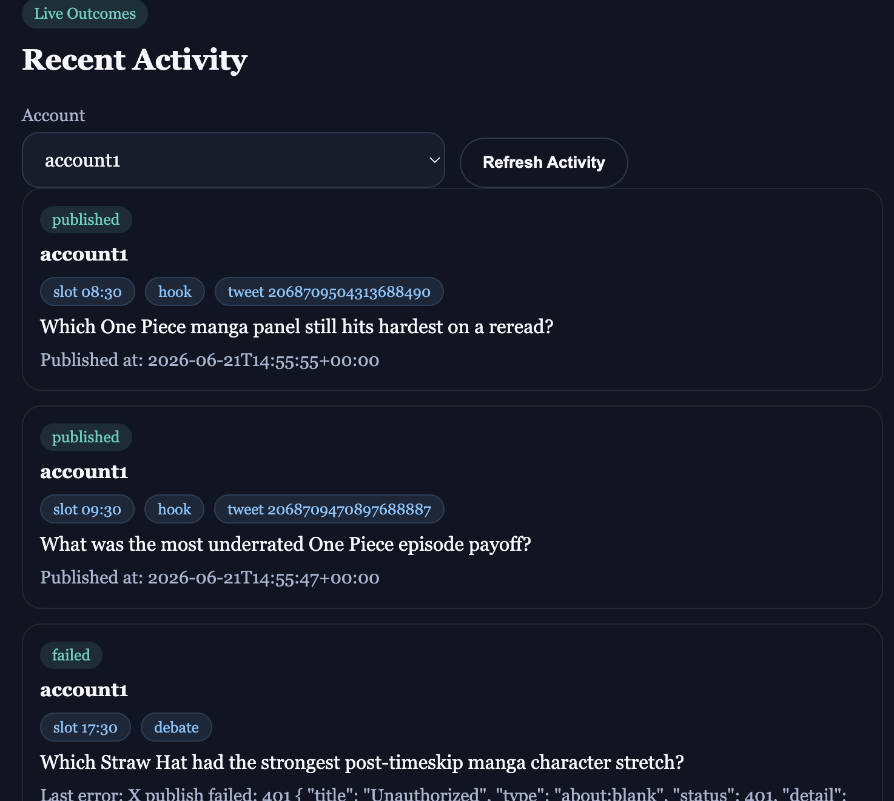
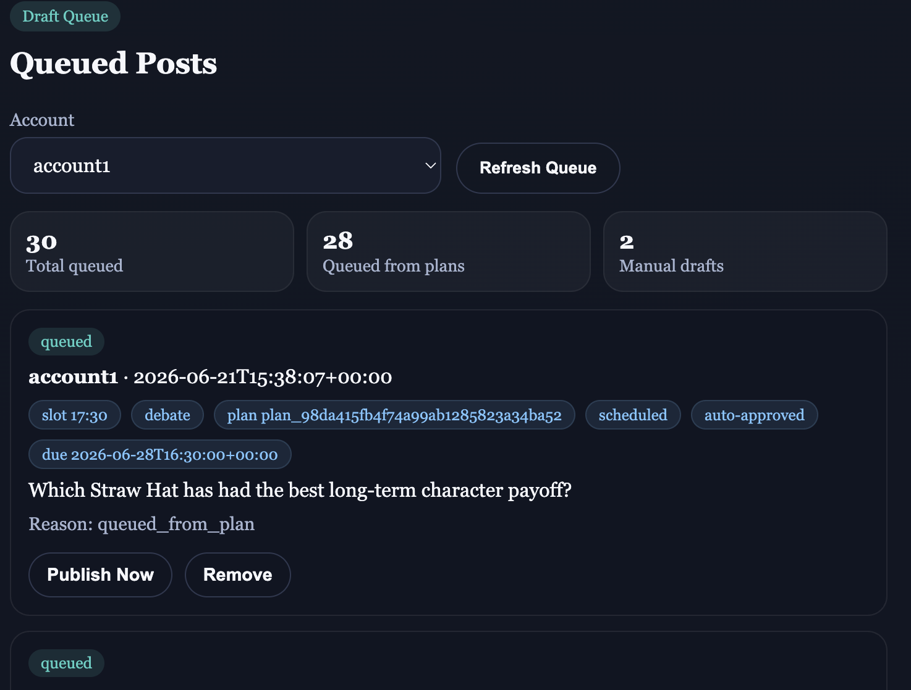

# AI-Powered Content Automation Platform

## Overview

Serverless social content automation platform built on AWS to manage daily publishing workflows across multiple X accounts.

The platform centralizes account connection, content planning, queued draft management, scheduled publishing, manual publish controls, and recent activity tracking through a browser-based control panel.

This project demonstrates practical platform engineering for creator operations by turning repetitive social publishing work into a structured, repeatable system with secure integrations and operational visibility.

---

## Portfolio Description

Designed and built a serverless social content automation platform on AWS to manage multi-account X publishing workflows. Implemented secure OAuth account connection, structured daily content planning, draft queue management, scheduled auto-publishing, manual publish controls, and activity tracking through a custom browser dashboard.

Built the platform using AWS Lambda, API Gateway, DynamoDB, EventBridge, AWS Secrets Manager, and AWS SAM. The system supports queue-based publishing operations, publish-state tracking, secure token handling, and repeatable content workflows that reduce manual effort and improve operational consistency.

---

## Key Features

* Multi-account X workflow management
* Secure OAuth account connection
* Daily content plan storage
* Queue-based draft and scheduled publishing
* Manual publish and remove controls
* Scheduled auto-publish using EventBridge
* Publish-state tracking across queued, published, failed, and removed posts
* Browser dashboard for operations
* DynamoDB-backed queue, plan, and activity data
* Secrets Manager-based credential and token storage

---

## Architecture

```text
                    Operator / Creator
                           │
                           ▼

                Browser Control Panel
                           │

      ┌────────────────────┼────────────────────┐
      ▼                    ▼                    ▼

   Daily Plans         Draft Queue         Activity Feed

      ▼                    ▼                    ▼

  Plan Storage       Scheduled Posts      Publish Results

                           │
                           ▼

                 AWS Lambda Service Layer
                           │

      ┌────────────────────┼────────────────────┬───────────────────┐
      ▼                    ▼                    ▼                   ▼

   API Gateway         DynamoDB         Secrets Manager        EventBridge
                                                                  │
                                                                  ▼
                                                                 X API
```

---

## Platform Engineering Concepts

This project demonstrates:

* Event-driven serverless design
* Self-service workflow automation
* Operational visibility for content systems
* Queue-based workload orchestration
* Secure external API integration
* Lightweight governance for publishing workflows
* Standardized scheduling and execution
* Platform-style tooling for repeatable operations

---

## Technologies Used

* AWS Lambda
* Amazon API Gateway
* Amazon DynamoDB
* Amazon EventBridge
* AWS Secrets Manager
* AWS SAM
* Python
* X API
* HTML
* CSS
* JavaScript

---

## Screenshots

### Control Panel Overview

High-level dashboard view showing connected accounts, queued work, saved plans, published content, and failed posts from a single operations interface.



---

### Daily Plan Library

Saved plan view showing structured post batches by account, date, slot, and content type.



---

### Live Published Posts on X

End-to-end proof that queued and scheduled posts were successfully published to the live X accounts.


---

### Multi-Account Connection Flow

Multi-account workflow managed through a single operations platform.


---

### OAuth-connected

Successful OAuth connection response confirming that X accounts were securely linked to the platform workflow.



---

### Publishing Activity Feed

Operational activity feed showing published and failed posts for monitoring workflow outcomes.



---

### Queue Management Workflow

Queued-post management interface showing scheduled content, slot metadata, publish controls, and removal actions.



---

### Xpost from account 1

Example live posts published for the first connected X account through the platform workflow.


---

### Xpost from account 2

Example live posts published for the second connected X account through the platform workflow.


---

## Skills Demonstrated

### Platform Engineering

* Serverless platform design
* Workflow automation design
* Operational dashboard development
* Queue and scheduler architecture
* Publishing governance and control patterns

### Cloud & Automation

* Lambda-based API implementation
* EventBridge scheduling
* DynamoDB data modeling
* Secrets and token management
* Infrastructure as code with AWS SAM

### Product & Operations

* Multi-account content operations
* Publishing queue lifecycle management
* Scheduled and manual release workflows
* Activity and outcome tracking
* Lightweight operator experience design

---

## Project Outcomes

This project demonstrates the ability to:

* Build a focused internal operations platform
* Replace manual social posting with structured workflows
* Coordinate multiple connected social accounts from one interface
* Implement scheduled and manual publishing safely
* Track operational outcomes across publish states
* Create a repeatable daily system for social content execution

---

## Repository Structure

```text
.
├── docs/
│   ├── account-launch-playbook.md
│   ├── next-24h-posting-plan.md
│   └── x-profile-avatar.svg
├── lambdas/
│   ├── common.py
│   ├── x_account_summary.py
│   ├── x_activity_list.py
│   ├── x_dashboard.py
│   ├── x_oauth_callback.py
│   ├── x_oauth_start.py
│   ├── x_plan_generate.py
│   ├── x_plan_list.py
│   ├── x_plan_queue.py
│   ├── x_plan_save.py
│   ├── x_publisher.py
│   ├── x_queue_list.py
│   ├── x_queue_publish.py
│   ├── x_queue_remove.py
│   └── x_queue_scheduler.py
├── templates/
│   └── template.yaml
├── tests/
│   └── test_x_platform.py
├── env.template.json
├── samconfig.toml
└── README.md
```

---

## Core Workflows

### Connect an account

`GET /oauth/x/start?account_id=account1`

### Save a daily plan

`POST /x/plan`

### Queue a saved plan

`POST /x/plan/queue`

### Queue a manual draft

`POST /x/post`

### Publish a queued post immediately

`POST /x/queue/publish`

### Review queued posts

`GET /x/queue?account_id=account1`

### Review recent activity

`GET /x/activity?account_id=account1`

### Open the dashboard

`GET /dashboard`

---

## Deployment

```bash
cd "/Users/olawaleazeez/.codex/worktrees/02a7/New project/one-piece-x-platform"
sam build -t templates/template.yaml
sam deploy --config-file samconfig.toml --region eu-west-2
```

---

## Current Scope

Current production scope:

* X account connection
* Two-account publishing workflow
* Daily plan creation and queueing
* Scheduled publishing windows
* Manual publish controls
* Activity history and failure visibility

Planned future scope:

* Duplicate-content detection
* Richer retry and rate-limit controls
* Analytics dashboard
* AI-assisted draft generation
* Media upload support
* Third-account expansion

---

## Why This Project Matters

Social publishing workflows often remain manual, inconsistent, and difficult to monitor.

This project shows how platform engineering ideas can be applied to content operations: structured workflows, secure integrations, scheduled execution, operational visibility, and a lightweight self-service interface for day-to-day publishing.

---

## Author

**Olawale Azeez**

Cloud Engineer | Platform Engineer | AWS Solutions Architect

Focused on Platform Engineering, AWS, automation, operational systems, and workflow design.
